# 可视化导论 · 重构版

> 把一门「讲义 + 三个 tab」的课程站点，重做成一套**可检索、可练习、可追踪**的学习系统。
>
> **在线站点**：<https://liquanlianshi.github.io/Layout_web4/> ｜ **源码仓库**：<https://github.com/liquanlianshi/Layout_web4>
>
> 5 章 · 27 节 · 20 种交互图（27 个交互实验）· 中英双语 · 深 / 浅双主题 · 纯静态离线可用

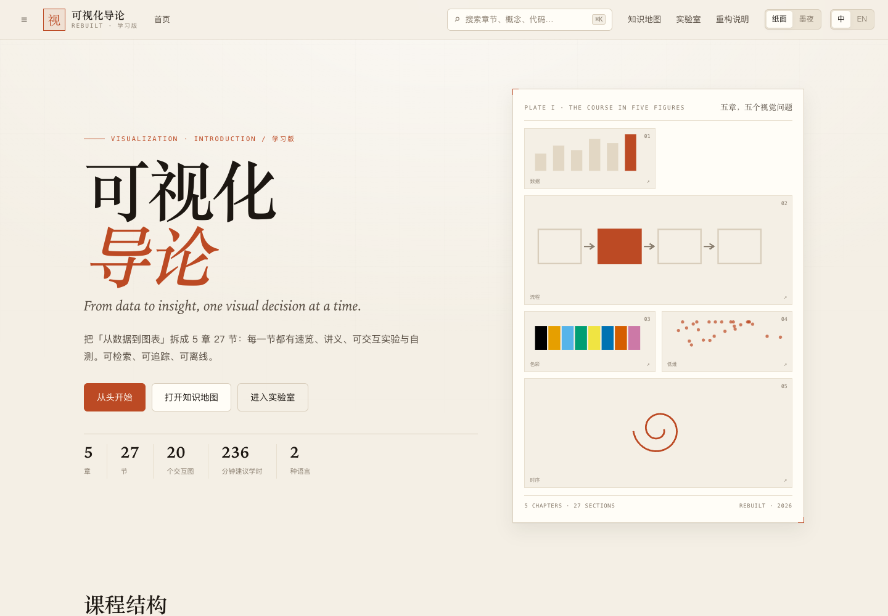

---

## 一、作业要求与完成情况对照

| 作业要求 | 完成情况 | 证据 |
|---|---|---|
| 对课程网站进行优化和重构 | 重新设计信息架构、阅读器、视觉系统与 20 个交互图；重写第 3、4、5 章，清理并统一第 1、2 章 | 本站 |
| 既可以在现有网站上添加功能，也可以完全重构 | 保留全部 27 节课程内容与知识结构，**完全重构外壳与呈现方式** | `data/course.js`；`assets/js/app.js` |
| 让内容展现更清晰 | 每节统一为「速览 → 动手实验 → 讲义 → 自测」四段；三层导航；代码块可复制；表格与提示框语义化 | 见第五、六节；`tests/content.mjs` 1734 项 |
| 更适合学习 | 27 个自测题、学习进度、知识地图完成度、全文检索、页内目录、上下节与键盘导航 | `shots/shot-08-map.png`、`shots/shot-02-reader.png` |
| 可以增加一些可视化图形 | 20 种交互图，覆盖通道矩阵、Data-Join、树布局、colormap、CVD、45° 倾角、等值线、日历、螺旋、Storyline | 见第四节；`tests/viz.mjs` 387 项 |
| 不要添加视频，服务器空间有限 | 站点**不含任何视频文件**；第三方库全部本地化，站点总体积约 1.2 MB | `tests/content.mjs` 视频扫描；`du -sh` |
| 1. 一个网页链接 | GitHub Pages：<https://liquanlianshi.github.io/Layout_web4/> | 已上线并验证 200 |

---

## 二、为什么重构：原站点的五个学习障碍

原站点（<https://cinger007.github.io/vis/>）的内容是扎实的：5 章、27 节，每章有「讲解 / 代码 / 演示」三个 tab。问题不在内容量，而在**学习路径**：

| # | 原站点的障碍 | 具体表现 | 对学习的影响 |
|---|---|---|---|
| 1 | 讲解、代码、演示被拆进三个 tab | 看原理时看不到代码，看代码时看不到效果，来回切换会丢上下文 | 抽象概念难以建立直觉 |
| 2 | 27 节没有检索 | 想找「rollup」「CVD」「Marching Squares」只能逐章滚动 | 复习与查漏补缺成本高 |
| 3 | 长页面缺少页内定位 | 一章一页，节与节之间没有稳定的锚点与进度 | 不知道自己读到哪、还剩多少 |
| 4 | 图多为静态截图 | 通道排名、Data-Join、树布局、colormap 只能「看」，不能「改」 | 读者记住结论，但没有形成操作感 |
| 5 | 没有进度与自测 | 学完无法确认「会不会」；换设备也无法继续 | 学习闭环缺失 |

> 一句话：原站点是**优秀的讲义仓库**，但还不是一个**学习系统**。

---

## 三、四条设计原则

### 1. 先给地图，再给路径

三层导航，任何一节最多两次点击到达：

- **课程目录**（左侧）：5 章 27 节，显示完成度、可折叠；
- **页内目录**（右侧）：当前节的 H3 标题与代码段，滚动时高亮；
- **知识地图**（独立页）：32 个节点（5 章 + 27 节）+ 相关边，完成度着色，可缩放、可筛选、可切列表。

### 2. 一页一个视觉问题

每节开头不是长导语，而是：

- **一句话**：这一节最核心的判断；
- **三个要点**：能在 30 秒内复述的抓手；
- **一个交互实验**：先动手，再读讲义；
- **讲义正文**：保留原课程的理论、代码与案例；
- **一个自测题**：选错也能看到「为什么」。

### 3. 让读者动手

20 种交互图不是「炫技」，每一种都对应一个具体的视觉问题：

- 选错通道会怎样？
- 数据从 5 条变 3 条，D3 到底做了什么？
- 红色盲眼里的红绿对比是什么样？
- 同一组数据，画布拉高一倍，读者会觉得增长更快吗？
- 日历热图的月份分隔线应该画在哪一格？

### 4. 可验证，而不是「看起来不错」

内容、双语、可视化、端到端、用户验收五套测试，共 **3967 项**检查；离线、响应式、无外部请求、无控制台错误都有断言。

---

## 四、20 种交互图（27 个交互实验）

| 章节 | 交互图 | 回答的问题 | 交互 |
|---|---|---|---|
| 1.1 数据生成 | CSV → 类型化对象 | 字段映射、类型转换、`trim()` 到底改变了什么？ | 逐行切换、开关 `trim()`、看班级计数被拆开 |
| 1.2 数据定义 | DIKW 金字塔 | 可视化能到达哪一层？ | 点击四层，看「图表直接完成 / 需要模型 / 到不了」 |
| 1.3 数据属性 | 尺度 × 通道矩阵 | 什么数据配什么通道？ | 4 种尺度 × 10 个通道，点击单元格看编码演示 |
| 1.4 数据变换 | 八个函数式操作 | map / filter / reduce / cross / group 分别做什么？ | 切换 8 个函数，看输入与输出 |
| 1.5 D3 选择器 | Data-Join 三态 | 数据变化时 enter / update / exit 如何分配？ | 增删、打乱、切换 key 函数 |
| 2.1 可视化流程 | Card / Mackinlay / van Wijk | 三个模型是什么关系？ | 切换模型、点击阶段看细节 |
| 2.2 数据变换 | 原始数据 → 数据表 | filter、derive、rollup 各自减少/增加了什么？ | 开关过滤与派生、切换聚合维度 |
| 2.3 视觉映射 | Reingold-Tilford 树 | 父节点如何居中、兄弟如何不重叠？ | 调 separation、切换朴素网格对照 |
| 2.4 渲染与交互 | 事件委托 + 动画时长 | 不 stopPropagation 会发生什么？ | 开关 stopPropagation、调 duration、看事件日志 |
| 3.1 颜色模型 | 色板 + CVD 模拟 | 色盲眼中的图是什么样？ | 切换 4 种色觉模拟、3 种示例图 |
| 3.2 colormap 三类 | 顺序 / 发散 / 定性 | 选错类型会怎样误导？ | 切换数据语义与 colormap，看判定 |
| 3.3 Lab 色域 | a–b 平面色域 | 哪些颜色在 sRGB 之外？ | 调 L*、点击取色、读 Lab / ΔE |
| 3.4 色系搭配 | 色轮 + 5 种规则 | 单色 / 类比 / 互补怎么选？ | 调基色、切换规则、看示例图 |
| 3.5 经典配色 | 6 套色板墙 | Wong / Tol / Tableau / Jet 差在哪？ | 全局 CVD 模拟、最小 ΔE |
| 3.6 对错案例 | 四张图三错一对 | 哪张才是对的？ | 点击选择、看解释、开 CVD |
| 3.7 配色生成器 | 7 色生成 | 怎样做到鲜艳又耐看？ | 调 H / S / L，看 7 个角色与最小 ΔE |
| 3.8 CVD 图测 | 5 × 5 ΔE 矩阵 | 模拟后哪两种颜色不可靠？ | 切换色板与模拟、读矩阵 |
| 4.1 数据转换 | 宽表 → 长表 | 一行一个实体，还是一行一个观测？ | 切换指标、看行数 6×4 → 24 |
| 4.2 坐标轴变换 | 数据 / 坐标系 / 屏幕空间 | margin 到底加在哪一层？ | 切 linear/log、调 margin、选州 |
| 4.3 曲线拟合 | 8 种 D3 curve | 插值还是拟合？ | 切换曲线、张力、显示数据点 / 线性参照 |
| 4.4 倾角感知 | 45° 黄金角 | 拉高画布会改变读者的判断吗？ | 调纵横比、切 log 轴、看误差曲线 |
| 4.5 等值线 | Marching Squares | 16 种 case 如何走线？ | 调阈值、网格密度、点击格子看 case |
| 5.1 时间属性 | 五个属性卡片 | 趋势、周期、叙事分别该用什么图？ | 点击属性看迷你图与图表建议 |
| 5.2 折线图 | 法国人名 1900–2020 | 时间轴与序号轴差在哪？ | 切序列、跳过 1940–1945、切序号轴、hover |
| 5.3 日历热图 | 7 × 53 全年温度 | 周内规律与节假日异常在哪？ | 月份分隔线开关、逐日 tooltip |
| 5.4 周期时间 | 阿基米德螺旋 | 同一季节如何对齐？ | 12 圈螺旋、导引线开关、逐日 tooltip |
| 5.5 Storyline | 侏罗纪公园 5 角色 | 关系如何随时间变化？ | 调 Catmull-Rom 张力、事件层开关 |
| 实验室 | 图表选择器 | 数据类型 × 阅读任务 → 什么图？ | 4 种数据类型 × 5 种任务，实时推荐与预览 |

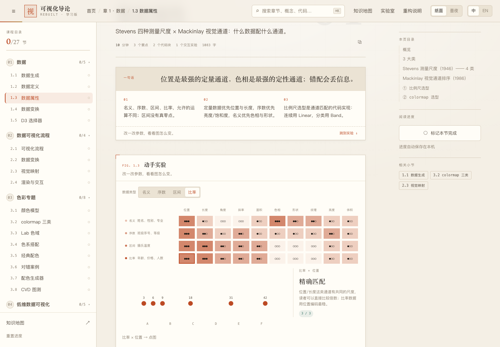

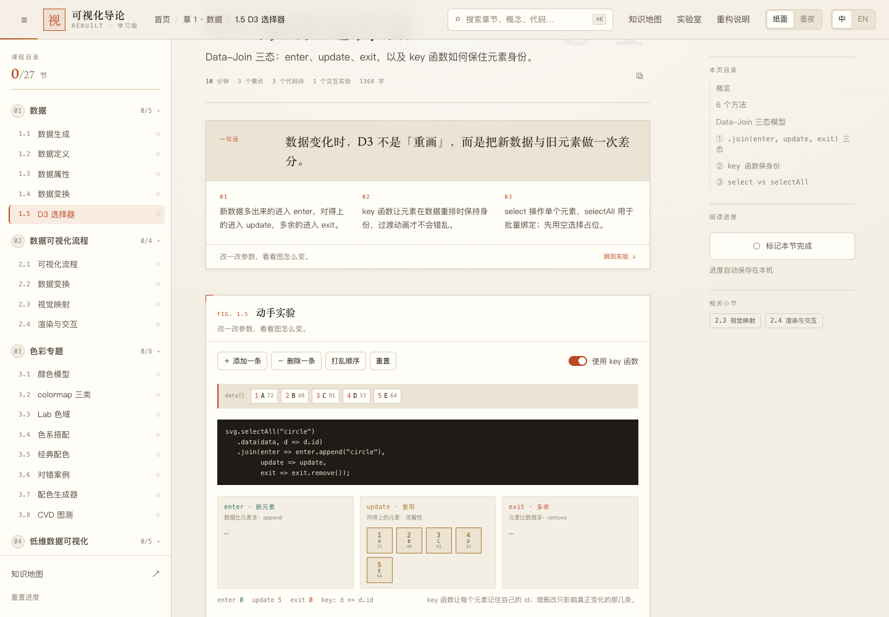

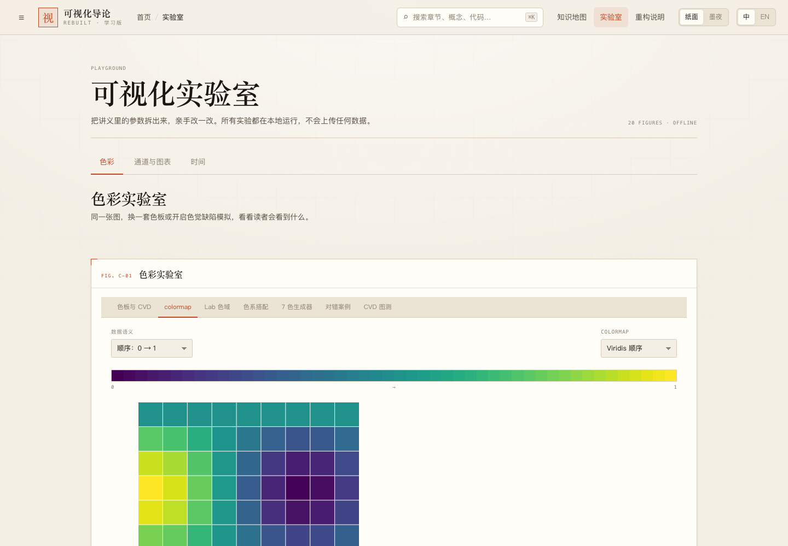

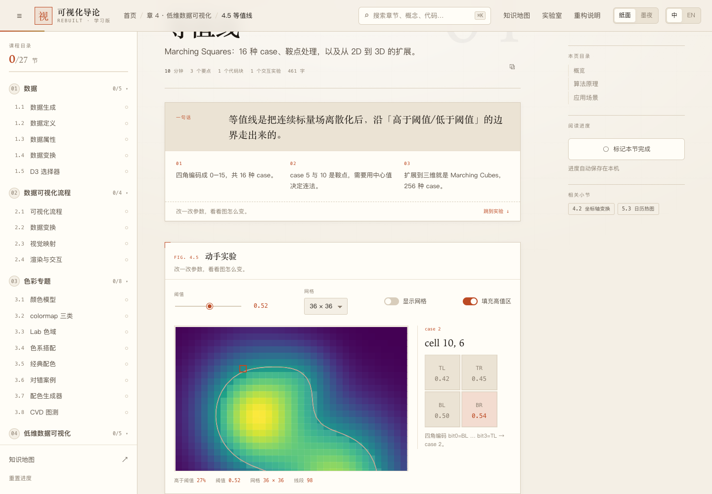

---

## 五、内容改造：不是搬运，而是重排

### 5.1 原讲义的真实问题

| 问题 | 位置 | 处理 |
|---|---|---|
| 第 4 章大量畸形列表（`- ` 空项、缩进错乱、`1.` 嵌在 `-` 里） | `ch4.zh.md` / `ch4.en.md` | **整章重写**：5 节全部重写为表格 + 代码 + 易错点 |
| 第 5 章列表与「1. 3 大元素」等结构错乱 | `ch5.zh.md` / `ch5.en.md` | **整章重写**：时间属性表、日历分隔线算法、螺旋 Δθ、Storyline 三元素 |
| 第 3 章 3.7 / 3.8 内容偏薄 | `ch3.zh.md` / `ch3.en.md` | **整章重写**：颜色空间、colormap、Lab 色域、5 种配色规则、CVD 矩阵与测试流程 |
| 原页面引用旧 `./index.html`、`img/*.png`、三 tab 导语 | 第 1、2 章 | 构建时清理，改为本站的交互图与统一版式 |
| 标题里的 `⭐`、`①` 与重复标签 | 全站 | 统一为「案例 / 理论 / 代码 / 小结 / 追问」五类语义块 |

### 5.2 规模

| 指标 | 数值 |
|---|---|
| 章节 / 小节 | 5 / 27 |
| 中文正文 | ≈ 23,000 字 |
| 英文正文 | ≈ 41,000 字符 |
| 代码块 | 90 个（中英各 45） |
| 表格 | 54 个（中英各 27） |
| 界面文案 | 226 键 × 2 语言 = 452 条 |
| 建议学时 | 236 分钟 |
| 交互实验 | 27 个（20 种图） |

### 5.3 代码与表格的阅读体验

- 代码块带语言标签、**一键复制**、深色高对比底；
- 表格在窄屏可横向滚动，不挤压正文；
- 提示框分为「注意 / 设计 / 提示」三类，颜色与左边框语义一致；
- 所有 H3 都有稳定锚点，右侧目录随滚动高亮；
- 中英文切换会同步切换正文、目录、速览、要点、自测与界面。

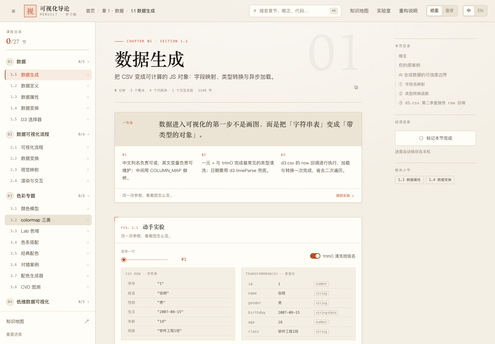

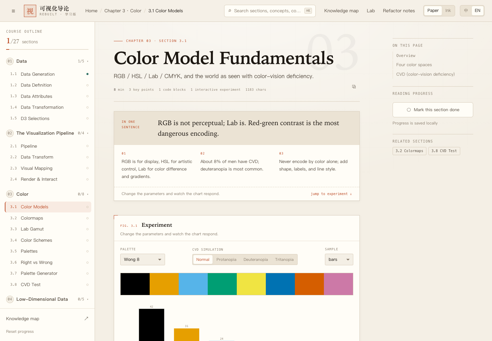

---

## 六、视觉与交互设计

### 6.1 纸面 / 墨夜

沿用前几次作业的**印刷图录**语言，但为长文阅读做了调整：

| 变量 | 纸面 | 墨夜 |
|---|---|---|
| 底色 | `#f4efe5` 暖纸 | `#12100d` 墨夜 |
| 卡片 | `#fffdf7` | `#1b1714` |
| 正文 | `#1c1712` | `#f2ebdd` |
| 主强调 | `#b3431f` 朱砂 | `#e0714a` |
| 辅强调 | `#2f6f62` 铜绿 | `#64b4a2` |
| 章节色 | 朱砂 / 铜绿 / 赭石 / 靛青 / 紫灰 | 对应提亮 |

标题用衬线体（Songti SC / Iowan Old Style），正文用无衬线（PingFang SC / system-ui），读数与代码用等宽体。两套主题共享同一组语义变量，D3 图表从 CSS 变量读取颜色，切换主题时图表会重新着色。

### 6.2 响应式与可访问性

- 五档断点：1920 / 1440 / 1100 / 900 / 560；
- 阅读器在 ≤1100px 时右栏变为正文后的进度与相关小节；≤900px 侧栏变抽屉；
- 键盘：`⌘K` / `Ctrl+K` 搜索、`/` 搜索、`←` / `→` 上下节、`M` 标记完成、`Esc` 关闭；
- 焦点环、跳转正文、语义化按钮、`aria-label`、`prefers-reduced-motion`；
- 移动端侧栏底部提供主题与语言开关。

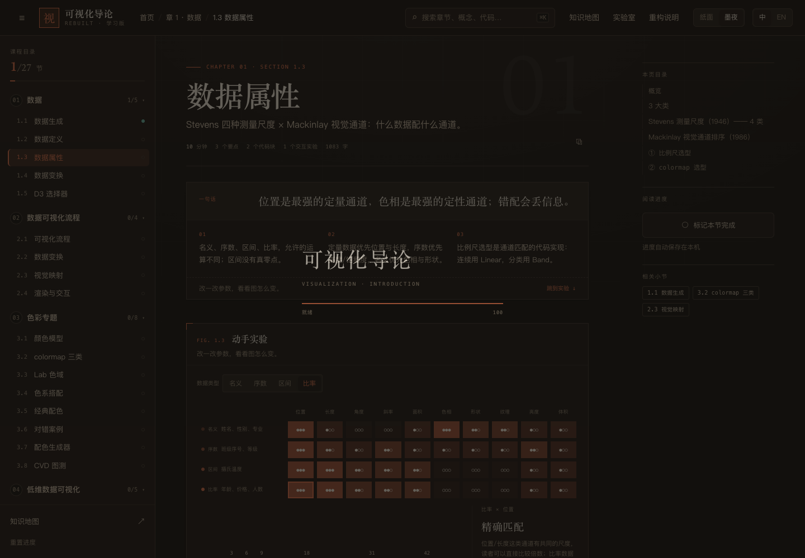

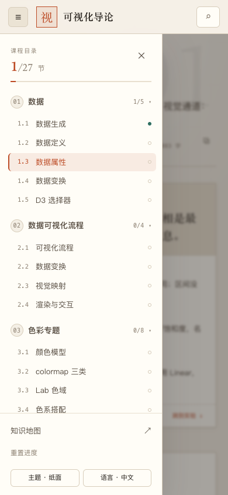

---

## 七、工程实现

### 7.1 目录结构

```
作业4/
├── index.html                    单页应用外壳
├── assets/
│   ├── css/
│   │   ├── tokens.css            主题变量 / 字体 / 基础排版
│   │   ├── layout.css            顶栏 / 侧栏 / 阅读器 / 首页 / 地图 / 响应式
│   │   ├── components.css        按钮 / 正文 / 代码 / 表格 / 自测 / 搜索
│   │   └── viz.css               交互图容器、坐标轴、图例与各图局部样式
│   ├── js/
│   │   ├── i18n.js               226 键 × 2 语言
│   │   ├── ui.js                 DOM / SVG / 存储 / 提示 / 控件
│   │   ├── app.js                路由、首页、阅读器、地图、实验室、搜索
│   │   └── viz/                  20 个交互图组件
│   └── vendor/                   D3 v7、Prism（全部本地化）
├── data/
│   ├── course.js                 构建产物：27 节双语 HTML + 目录 + 统计
│   ├── datasets.js               内嵌数据集（file:// 可用）
│   ├── newstudent.csv / crime.csv / weather_2024.csv / french_names.json
├── content/
│   ├── md/ch1–ch5.zh.md / .en.md 双语讲义源文件
│   └── meta.js                   章节结构、速览、要点、自测、相关小节
├── tools/build.mjs               Markdown → HTML 构建 + 完整性检查
├── tests/
│   ├── content.mjs               1734 项内容 / 结构 / 离线审计
│   ├── i18n.mjs                  1716 项双语结构 / 占位符 / 调用点
│   ├── viz.mjs                   387 项交互图浏览器自检
│   ├── e2e.mjs                   90 项端到端
│   └── uat.mjs                   40 项用户视角验收
├── shots/                        24 张截图
└── README.md
```

### 7.2 构建流程

```bash
npm install            # 只装构建与测试依赖（站点本身零依赖）
npm run build          # content/md + content/meta.js → data/course.js
```

构建脚本负责：

1. 清理旧站点的三 tab 导语、`./index.html` 链接、图片占位；
2. 按 `## x.y` 切分 27 节，中英分别渲染；
3. 给 H3 分类（案例 / 理论 / 代码 / 小结 / 追问），加锚点与徽标；
4. 代码块加语言标签与复制按钮，表格加响应式容器；
5. 校验每节双语、三个要点、自测答案索引、组件注册、章节归属。

### 7.3 离线与隐私

- 所有脚本、样式、数据、字体栈都在本地；**无外部 CDN、无跟踪脚本、无视频**；
- 数据集内嵌为 `data/datasets.js`，双击 `index.html` 即可运行；
- 学习进度只写入 `localStorage`，不上传任何数据；
- `tests/e2e.mjs` 断言页面没有任何 `file://` 之外的请求。

---

## 八、如何验证

```bash
# 1）内容与结构：1734 项
node tests/content.mjs

# 2）双语字典：1716 项
node tests/i18n.mjs

# 3）交互图：387 项（真实 Chromium）
PLAYWRIGHT_BROWSERS_PATH="$PWD/.pw-browsers" node tests/viz.mjs

# 4）端到端：90 项
PLAYWRIGHT_BROWSERS_PATH="$PWD/.pw-browsers" node tests/e2e.mjs

# 5）用户视角验收：40 项
PLAYWRIGHT_BROWSERS_PATH="$PWD/.pw-browsers" node tests/uat.mjs

# 一次性运行
PLAYWRIGHT_BROWSERS_PATH="$PWD/.pw-browsers" npm test
```

当前结果：

| 测试 | 检查项 | 结果 |
|---|---|---|
| 内容 / 结构 / 离线 | 1734 | ✅ 0 失败 |
| 双语字典 / 占位符 / 调用点 | 1716 | ✅ 0 失败 |
| 交互图 / 地图 / 实验室 | 387 | ✅ 0 失败 |
| 端到端（路由、搜索、进度、主题、响应式） | 90 | ✅ 0 失败 |
| 用户视角验收 | 40 | ✅ 0 失败 |
| **合计** | **3967** | **✅ 100%** |

测试覆盖的关键断言：

- 5 章 27 节顺序、归属、唯一 id；每节中英双语、三个要点、自测答案索引合法；
- 20 个组件全部注册；27 节引用的组件都存在；90 个代码块、54 个表格结构完整；
- 每个 SVG 有内容、可见宽度、合法 `viewBox`，组件内无 `NaN` / `undefined` 属性；
- 366 格日历、40 格矩阵、32 个地图节点、27 个列表项；
- 7 个色彩子页、2 张通道卡、4 张时间卡全部可切换；
- 7 个视口 × 4 个页面无横向溢出；390 / 768 / 900 / 1024 / 1280 / 1440 / 1920 均通过；
- 离线加载无外部请求、无控制台错误；
- 进度持久化、主题持久化、语言持久化、重置进度。

---

## 九、部署

站点是纯静态产物，无构建步骤：

```bash
# 本地
python3 -m http.server 8080
# 浏览器打开 http://localhost:8080

# GitHub Pages
git push origin main
# Settings → Pages → Deploy from a branch → main / (root)
```

- **在线**：<https://liquanlianshi.github.io/Layout_web4/>
- **仓库**：<https://github.com/liquanlianshi/Layout_web4>
- **页面体积**：约 1.2 MB（含 D3 与 Prism）
- **无后端、无数据库、无外部请求**

---

## 十、截图

| | |
|---|---|
|  |  |
| 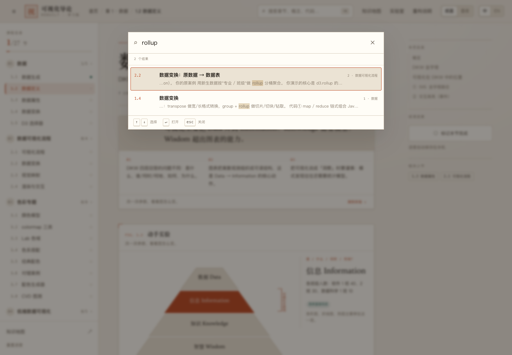 | 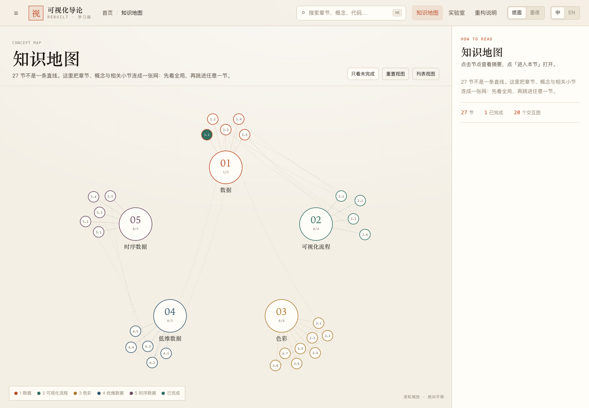 |
|  | 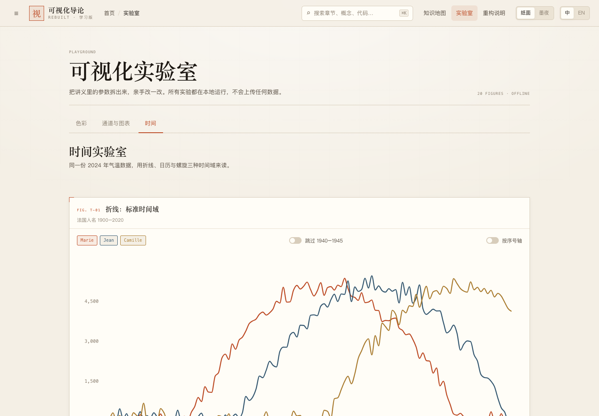 |
| 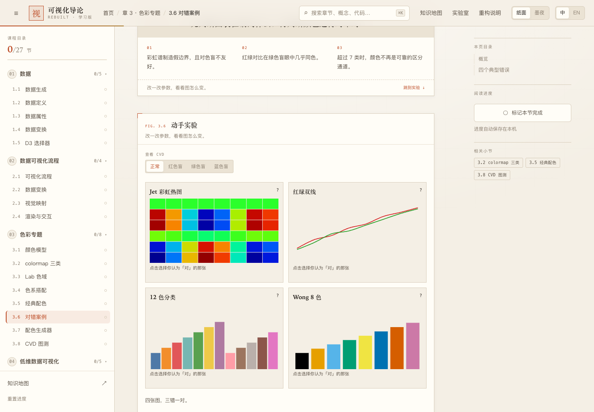 | 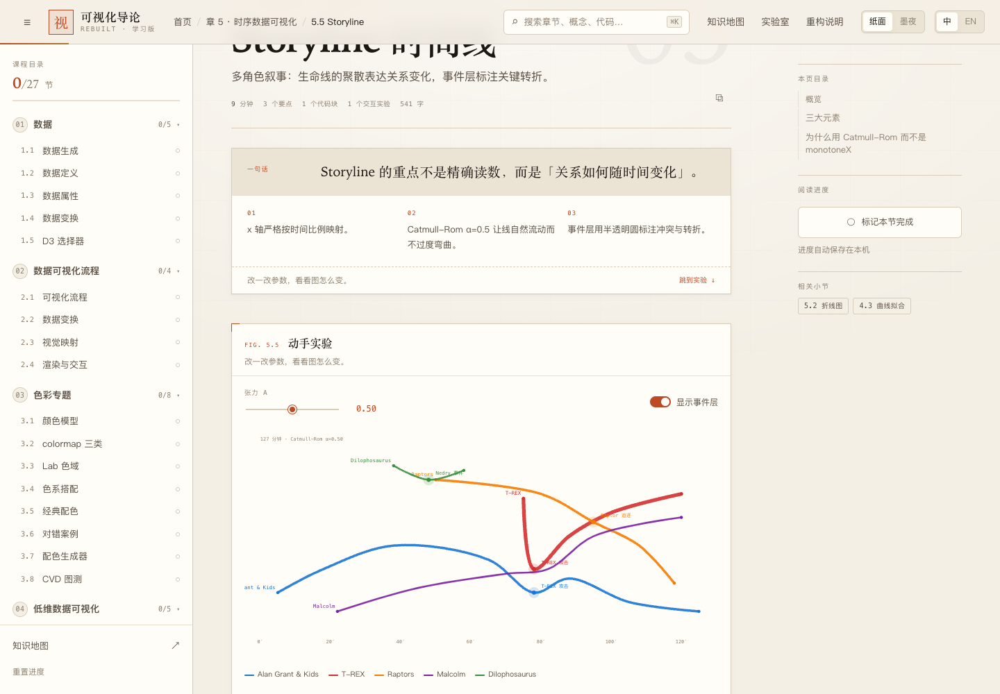 |

---

## 十一、局限与下一步

1. **内容仍以原课程为底本**：重写集中在第 3–5 章；第 1、2 章保留原讲义的细节，只做结构化与清理。
2. **英文正文部分沿用原站翻译**：术语与代码注释仍有中文，后续可做一轮术语表驱动的校对。
3. **进度只在本机**：没有账号与后端，换设备不同步；这是「纯静态 + 隐私优先」的取舍。
4. **知识地图是固定布局**：节点位置由章节与相关关系决定，没有做力导向自动布局，以保证稳定与可截图。
5. **下一步**：间隔重复复习、划词笔记、URL 分享当前滚动位置、把 27 个自测扩展成章节测验。

---

## 十二、内容来源与致谢

- 课程内容基于《可视化导论》课程站点（<https://cinger007.github.io/vis/>，授课教师：李昕）重构，仅用于课程作业。
- 理论引用：Card / Mackinlay / Shneiderman 1999；Mackinlay 1986；Stevens 1946；Cleveland 1984；van Wijk 2005；Reingold & Tilford 1981；van Wijk 2008；Wong 2011；Okabe & Ito 2002；Paul Tol；Lorensen & Cline 1987。
- 第三方库：D3.js v7（ISC）、Prism（MIT），均已本地化。
- 数据集：新生数据（DeepSeek 合成）、1985 美国犯罪数据、2024 北京气温、法国人名频率、侏罗纪公园 Storyline（课程原数据）。

---

*《可视化导论》课程作业 4 · 纯静态 · 离线可用 · 无跟踪脚本*
